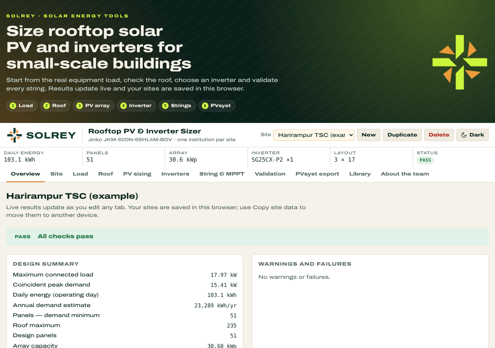

<p align="center">
  
</p>

<h3 align="center">Rooftop Solar PV &amp; Inverter Sizer</h3>

<p align="center">
  Size rooftop solar PV arrays and inverters for small-scale buildings and institutions — from equipment load to a validated string layout and PVsyst-ready inputs.
</p>

<p align="center">
  
</p>

---

## About

**SOLREY** (from *solar ray* / *sun ray*) is a browser-based worksheet for preliminary rooftop solar PV design. It was built to support a rooftop solar feasibility study of government educational institutions in Bangladesh, and works for any small-scale building: schools, training centres, offices, clinics and similar facilities.

Everything runs in a single HTML file. There is no server, no sign-up and no build step. Results update live as you type, and your sites are saved in your own browser.

## Features

- **Equipment load:** enter loads per location and equipment type, grouped as class-hour, continuous (24 h) or intermittent. You get connected load, coincident peak, daily energy, annual demand and an hourly load profile chart. You can also paste rows straight from Excel.
- **Roof assessment:** enter roof sections by length × width or direct area. Orientation factors cover flat and pitched roofs, and the tool works out the maximum number of panels the roof can hold.
- **PV sizing:** sizes the array from energy demand, with three scenarios: demand minimum, demand plus growth margin, and roof maximum. The design never exceeds the roof limit.
- **Inverter selection:** checks every model in the library for quantity, DC:AC ratio, string fit and roof limit, then ranks them. Ranking favours fewest units, then DC:AC closest to target, then panel count closest to target.
- **String &amp; MPPT design:** three layout options for the selected inverter, checked against voltage and current limits.
- **Design validation:** a full checklist with PASS, WARN, FAIL and INFO results covering inputs, roof, module, inverter, strings, electrical, configuration and grid.
- **PVsyst export:** the values you need for PVsyst's Orientation, System, Detailed losses and User needs screens.
- **Equipment library:**
  - Default module: Jinko JKM-600N-66HL4M-BDV.
  - Inverters: Sungrow, Huawei, Growatt and Solis models, each linked to its datasheet.
  - Values that need checking against the datasheet are flagged VERIFY.
  - You can edit the library per site.
- **Multiple sites:** create, duplicate and delete sites. To move them to another device or browser, use *Copy site data* and then *Import site data*.
- **Light and dark mode:** follows your system setting, with a manual switch in the toolbar.

## Workflow

| Step | Tab | What you do |
|---|---|---|
| 1 | **Site** | Institution details, grid connection, operating schedule and design assumptions |
| 2 | **Load** | List equipment by location and usage group |
| 3 | **Roof** | Measure usable roof sections and pick the orientation |
| 4 | **PV sizing** | Review the array size under each scenario |
| 5 | **Inverters** | Compare ranked inverter options and pick one |
| 6 | **String &amp; MPPT** | Choose a string layout for the selected inverter |
| 7 | **Validation** | Fix any FAIL items and review WARN items |
| 8 | **PVsyst export** | Copy the values into PVsyst for detailed simulation |

The **Overview** tab summarises the whole design, and the result strip under the toolbar (daily energy, panels, array size, inverter, layout, status) is always visible.

## Getting started

### Use it online

Open the hosted version: `https://<your-username>.github.io/<repo-name>/`

### Run it locally

1. Download or clone this repository.
2. Open `index.html` in any modern browser (Chrome, Edge, Firefox or Safari).

That's all. The page works offline. With an internet connection it loads the Archivo and IBM Plex Mono fonts from Google Fonts; without one it falls back to system fonts.

### Host it on GitHub Pages

1. Push this repository to GitHub, with the page saved as `index.html` in the root.
2. Go to **Settings → Pages**.
3. Under **Build and deployment**, choose **Deploy from a branch**, select `main` and the `/ (root)` folder, then save.
4. After a minute or so, the site is live at `https://<your-username>.github.io/<repo-name>/`.

## Repository structure

```
├── index.html                  # The complete app (HTML, CSS and JavaScript in one file)
├── README.md
└── docs/
    ├── solrey-logo-light.svg   # Logo for light backgrounds
    ├── solrey-logo-dark.svg    # Logo for dark backgrounds
    ├── solrey-icon-dark.svg    # App icon / favicon
    ├── screenshot-light.png
    └── screenshot-dark.png
```

## Your data

Site data is stored only in your browser's local storage. Nothing is sent to a server. Clearing your browser data deletes your saved sites, so use **Copy site data** to keep a backup.

## Important note

SOLREY is a **preliminary sizing tool**. Orientation factors are planning assumptions, and some inverter values are marked **VERIFY** where datasheets are ambiguous. Always confirm the final design against current manufacturer datasheets, a detailed PVsyst simulation, and local grid and net-metering rules before procurement or installation.

## Brand

| Colour | Hex |
|---|---|
| Night Green | `#0B1F1A` |
| Deep Green | `#0E3B2E` |
| Ray Lime | `#D4FF3F` |
| Sun Orange | `#F5871F` |
| Cream | `#F6F1E4` |

Headings use [Archivo](https://fonts.google.com/specimen/Archivo) (SIL Open Font License) at expanded width; numbers use [IBM Plex Mono](https://fonts.google.com/specimen/IBM+Plex+Mono).

## Author

**Ashraf Al-Khalique** · [ashrafalkhalique.github.io](https://ashrafalkhalique.github.io)

Contributions, bug reports and suggestions are welcome. Please open an issue.
